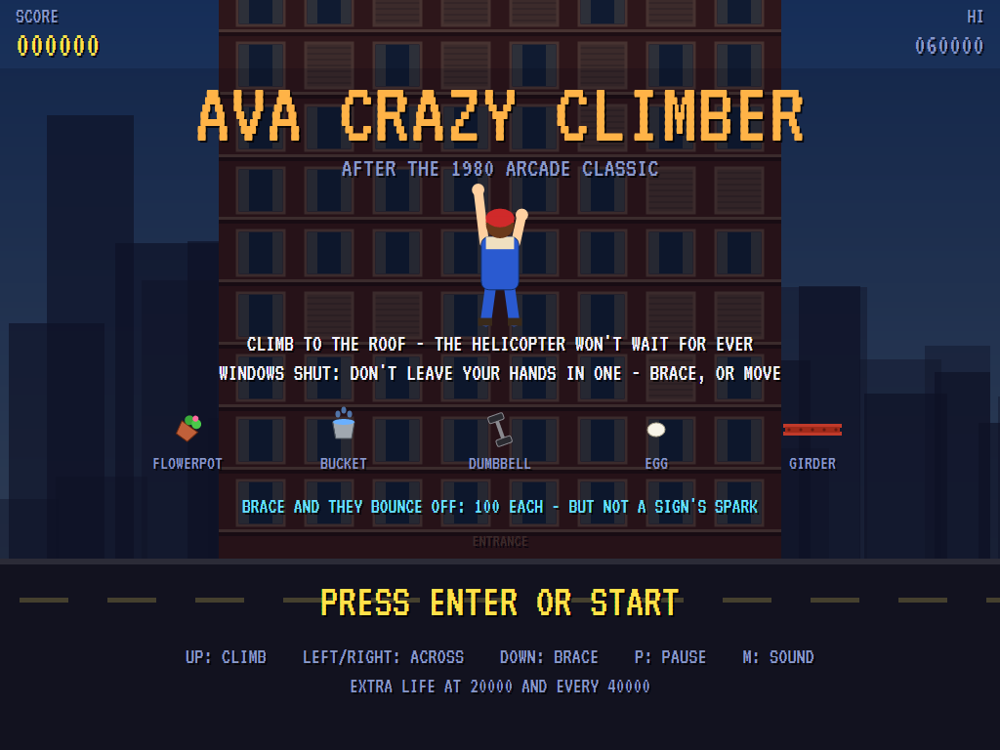
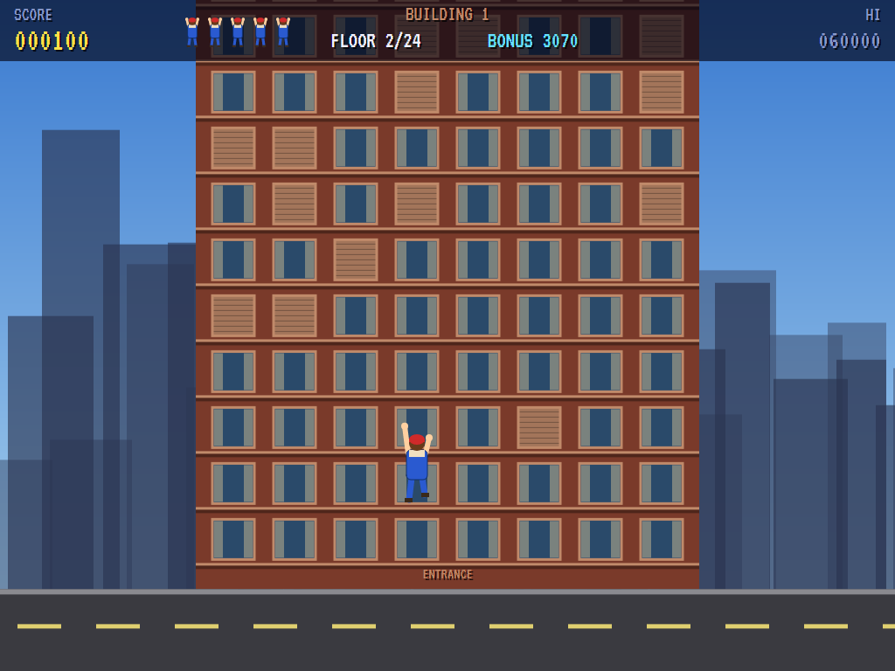
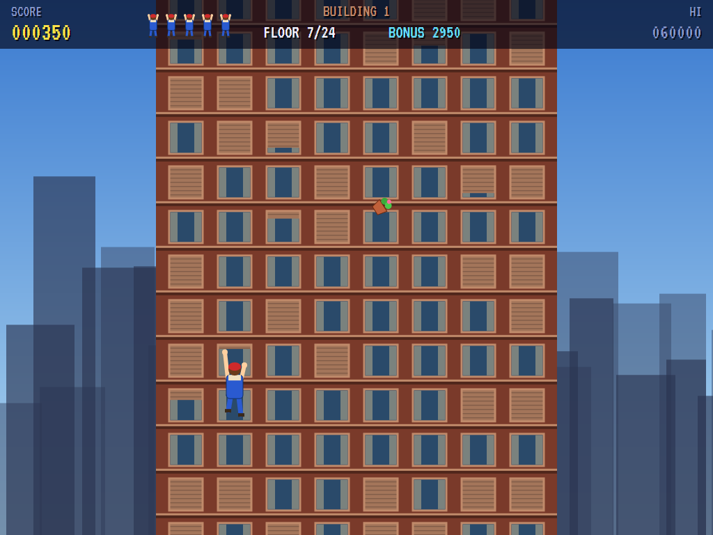
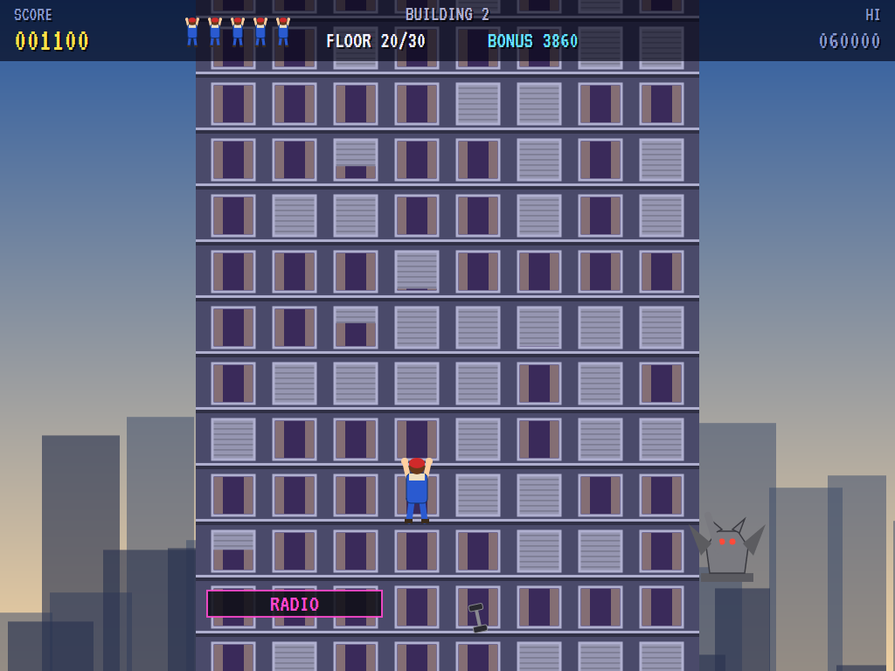
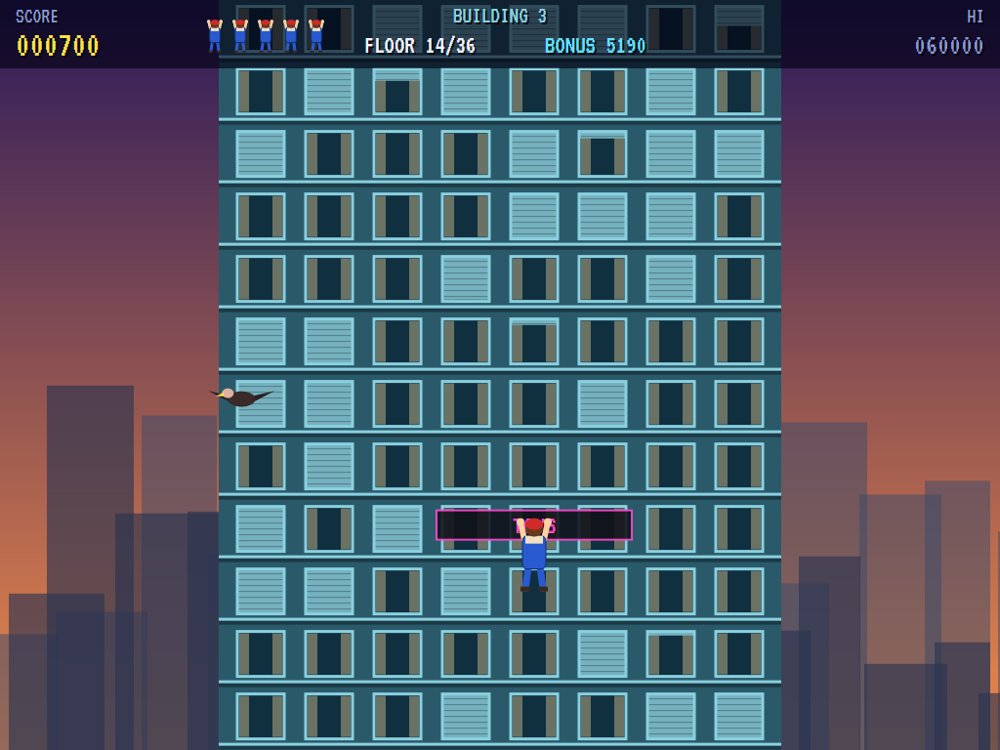
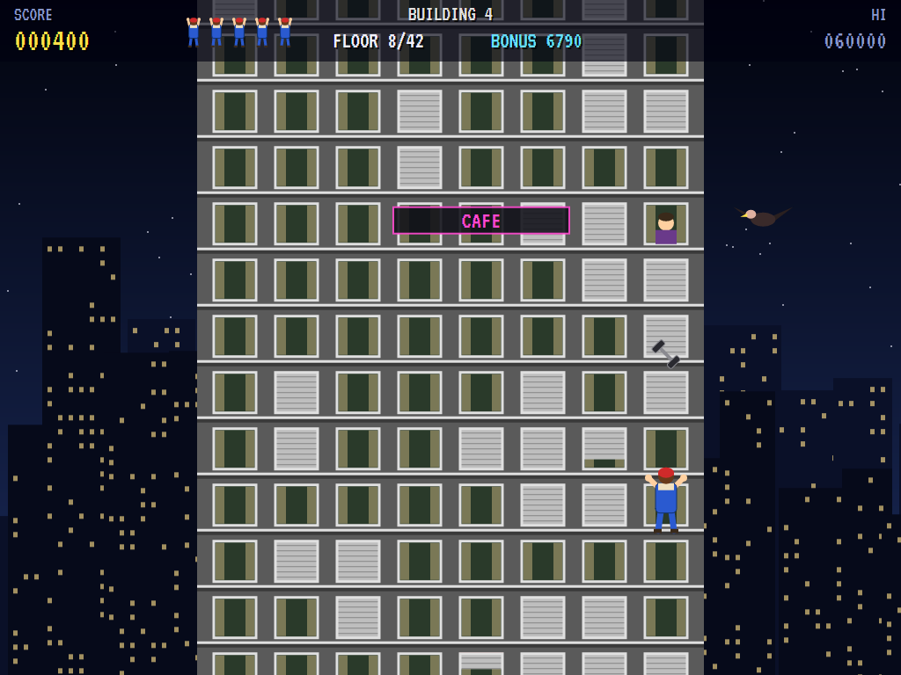
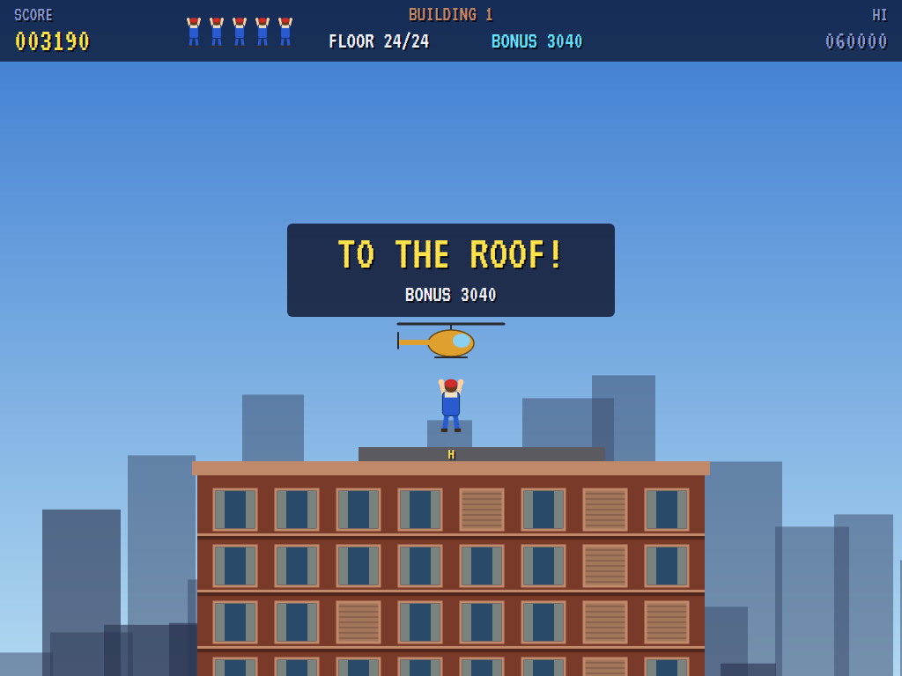
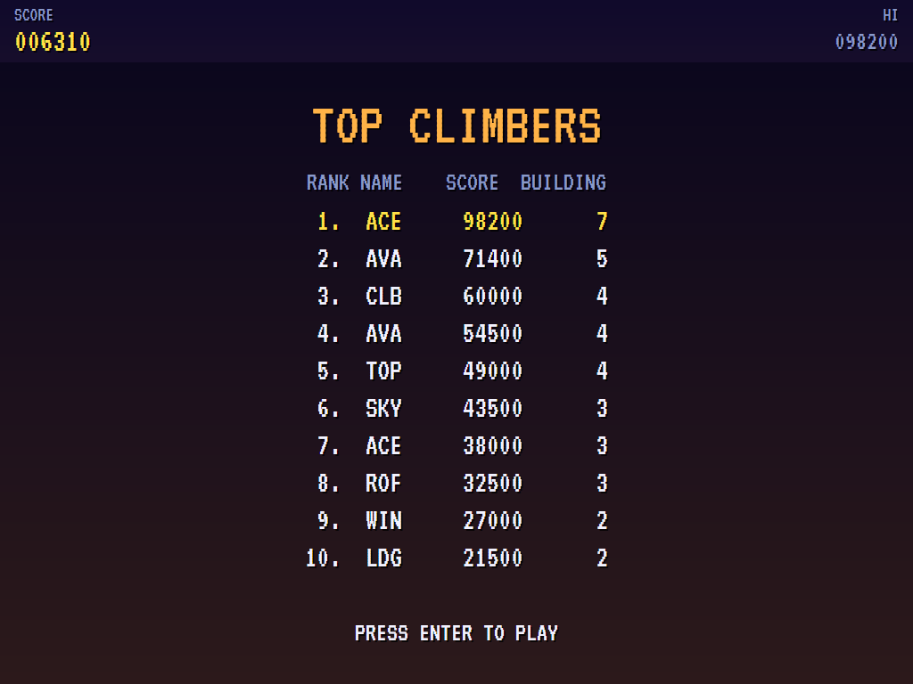

# AVA Crazy Climber

[](https://github.com/Harlock123/AVACrazyClimber/actions/workflows/build.yml)

A building-climbing game in the style of Nichibutsu's 1980 arcade game **Crazy Climber**, built with .NET 10 and
Avalonia UI. Scale the face of a skyscraper hand over hand, window by window, to the helicopter waiting on the
roof. The windows open and shut on their own, and one that shuts on your hands will knock you off. The
residents drop things on you, and further up there's a stone gargoyle, a vulture and sparking neon signs.
Brace against the wall at the right moment and most of it bounces off.

## Features

- **The climb**: hold Up and the climber reaches a hand at a time, two reaches to a floor. It can only reach
  into a window that's open; left and right shift it across to the next column, again only where the window
  is open.
- **Bracing**: hold Down and the climber presses flat to the wall. It can't move, but things dropped on it
  bounce off (100 points each), the gargoyle's swipe can't shift it, and a window shutting on its hands won't
  knock it off.
- **The windows**: open, then a shutter coming down (it flashes red: get your hands out or brace), shut for
  a while, then open again. The bottom floors never shut, and on every floor at least one window never does,
  so there's always a way on up.
- **The dangers**:
  - **Residents** lean out of open windows above and drop flowerpots, buckets of water and dumbbells
    straight down the column.
  - **Girders** fall from the work on the roof as you near the top.
  - **The gargoyle**, on the second and fourth buildings, sits on a ledge beside the face. When you come
    near it, its eyes glow, it raises an arm, and then it swipes across the columns on its side.
  - **The vulture**, on the third and fourth buildings, crosses the sky and drops an egg on you.
  - **Neon signs** across some floors flicker, then spark, and anyone on them then is thrown off, braced or
    not.
- **Four buildings**, each taller than the last (24 to 42 floors), each under its own sky: morning,
  afternoon, sunset and night. After the fourth they come round again, busier.
- **The roof**: the helicopter takes you off for a bonus of 1000 a building plus 30 for each second left on
  the clock. Floors climbed are 50 each; extra lives at 20000 and every 40000.
- **The attract mode** plays itself: a computer climber that steps aside from or braces against what's
  falling, braces for the gargoyle and for windows about to shut, waits out the signs, and works its way
  across to a column it can climb.
- **The sounds** are all synthesised: hands on the sills, shutters slamming, the whistle of something falling,
  the bonk off your head, the long fall, the gargoyle, the vulture, the sign's crack, the rotor, a climbing
  tune and a brassy title march.

## Screenshots

| The title | The street | Something falling |
|:---------:|:----------:|:-----------------:|
|  |  |  |
| The climber, and what comes down. | Starting up. | A flowerpot on its way. |

| The gargoyle | A neon sign | Bracing |
|:------------:|:-----------:|:-------:|
|  |  |  |
| Its eyes glowing. | Sunset, and a vulture. | Flat to the wall. |

| The roof | The high scores | |
|:--------:|:---------------:|:-:|
|  |  | |
| Lifted off by the helicopter. | The top climbers. | |

The screenshots are made by the tests, which play the game in a real (headless) window; see
[Tests](#tests).

## Download and run

Ready-to-run builds for Windows, macOS and Linux, on both Intel/AMD and ARM, are on the
[Releases page](https://github.com/Harlock123/AVACrazyClimber/releases/tag/latest). **Latest build** is
rebuilt on every push to `main`. Each download is one self-contained executable: no .NET install is
needed.

| Platform | Archive |
|---|---|
| Windows | `AVACrazyClimber-win-x64.zip`, `AVACrazyClimber-win-x86.zip`, `AVACrazyClimber-win-arm64.zip` |
| macOS | `AVACrazyClimber-osx-arm64.tar.gz` (Apple silicon), `AVACrazyClimber-osx-x64.tar.gz` (Intel) |
| Linux | `AVACrazyClimber-linux-x64.tar.gz`, `AVACrazyClimber-linux-arm64.tar.gz`, `AVACrazyClimber-linux-arm.tar.gz` |

```bash
tar -xzf AVACrazyClimber-linux-x64.tar.gz     # or linux-arm64, linux-arm, osx-arm64, osx-x64
./AVACrazyClimber
```

On Windows, unzip and run `AVACrazyClimber.exe`. On macOS, if Gatekeeper refuses to open it, run
`xattr -d com.apple.quarantine AVACrazyClimber` once. Run with `--no-audio` for silence.

**Sound** comes through OpenAL Soft, built in for every platform. In a virtual machine the game
detects it and uses a larger audio buffer, so the sound doesn't break up.

**Gamepads** use SDL2, which is bundled for Windows, macOS and Intel/AMD Linux. ARM Linux builds need it
installed; without it the keyboard still works:

```bash
sudo apt install libsdl2-dev            # Debian / Ubuntu / Raspberry Pi OS
sudo pacman -S --needed sdl2-compat     # Arch / Omarchy
```

## Controls

| Input | Action |
|-------|--------|
| **Enter** | Start |
| **Arrow keys** / **W A S D** | Walk (diagonals too) |
| **Space** / **Z** / **X** / **Ctrl** | Shoot an arrow, the way you last walked (in a room) |
| **P** / **Esc** | Pause (Esc again to quit) |
| **M** | Mute |
| **Ctrl+S** / **Cmd+S** | Save a screenshot to the Pictures folder |

**Gamepad**: left stick or D-pad to walk, **A**, **B**, **X** or the right trigger to shoot, **Start** to
start and pause, **Back** (while paused) to quit.

**Entering initials**: type letters, or dial with **Up**/**Down** and accept with **Space**; **Left** /
**Backspace** go back; **Enter** finishes.

## Controls

| Action | Keyboard | Gamepad |
|---|---|---|
| Climb | Up, W or Space (hold) | Up or A |
| Across | Left / Right (or A / D) | Left stick / D-pad |
| Brace | Down, S or Shift (hold) | Down, B or X |
| Start | Enter | Start |
| Pause | P or Esc | Start |
| Sound on/off | M | |
| Screenshot | Ctrl+S (to your Pictures folder) | |

On the high-score table, type your initials, or use up/down and Space, then Enter.

## Tests

```bash
dotnet test AVACrazyClimber.slnx
```

The engine has no UI and runs in fixed 60 Hz steps, so it plays the same at any frame rate, and a seed
always plays the same game. The tests check:

- **Climbing:**
  - a hand at a time, two reaches to a floor, and settling back when let go
  - shut windows above stopping it
  - shifting across only to open windows
  - bracing holding it still
- **Windows:** shutting on its hands (and bracing against it), and opening and shutting on their own, with a way up always left open
- **Things dropped:**
  - knocking the climber off, or bouncing off a brace for points
  - missing the next column
  - residents leaning out to drop them
- **The gargoyle, the signs, the vulture:**
  - the swipe and its reach, and only a brace saving you
  - a sign's spark throwing you off regardless
  - the vulture's egg
- **Falling and the roof:**
  - back on the same floor, safe a moment, and the last life
  - the roof's bonus and the next building
  - each building taller and busier
  - points and extra lives
- **The machine:** the attract cycle, the computer climber reaching the first roof, the same game from the same seed, and pausing

The screenshot tests draw the real screen in a headless window. To refresh the README's pictures:

```bash
CLIMBER_SHOTS=$PWD/Images dotnet test tests/AVACrazyClimber.Tests --filter ScreenshotTests
```

To see how the computer climber gets on, building by building (for tuning):

```bash
CLIMBER_PROBE=1 dotnet test tests/AVACrazyClimber.Tests --filter PilotProbe --logger "console;verbosity=detailed"
```

## Building

```bash
dotnet build AVACrazyClimber.slnx
dotnet run --project src/AVACrazyClimber
```

Needs the .NET 10 SDK. The sounds are made by `tools/make_sounds.py` (standard-library Python):
`python3 tools/make_sounds.py` rewrites `src/AVACrazyClimber/Sounds`.

## Project structure

```
AVACrazyClimber/
├── AVACrazyClimber.slnx
├── src/AVACrazyClimber/
│   ├── Engine/
│   │   ├── GameEngine.cs        # States, the title and demo cycle, and the climbing tune
│   │   ├── GameEngine.Play.cs   # The windows, the climber's reaches, shifts and bracing; residents,
│   │   │                        # girders, the gargoyle, the vulture and the signs; the roof and scoring
│   │   ├── ShipPilot.cs         # The computer climber, for the demonstration (and the tests)
│   │   ├── Entities.cs          # The buildings, the windows, the climber and the dangers
│   │   ├── HighScoreTable.cs, InitialsEntry.cs
│   │   ├── InputHandler.cs, ControllerManager.cs  # Keys and an SDL2 gamepad
│   │   └── SoundManager.cs      # Effects and the tunes through OpenAL
│   ├── Audio/                   # The OpenAL engine (from the author's AVABand)
│   ├── Views/                   # The skies and the city, the building, the climber and the screens
│   └── Sounds/                  # The synthesised effects and tunes
├── tests/AVACrazyClimber.Tests/ # Gameplay, screenshot and probe tests
├── tools/make_sounds.py
└── Images/                      # Screenshots
```

## About and licence

AVA Crazy Climber © 2026 Lonnie Watson, under the [MIT License](LICENSE).

*Crazy Climber* © 1980 Nichibutsu; the name belongs to its current owner. AVA Crazy Climber is an independent,
unofficial game in its style. Its climber, its buildings, residents, gargoyle and vulture, its graphics,
sounds, tunes and code are its own; nothing is taken from the arcade machine's program, graphics, sound or
music. It is not affiliated with or endorsed by any rights holder.
